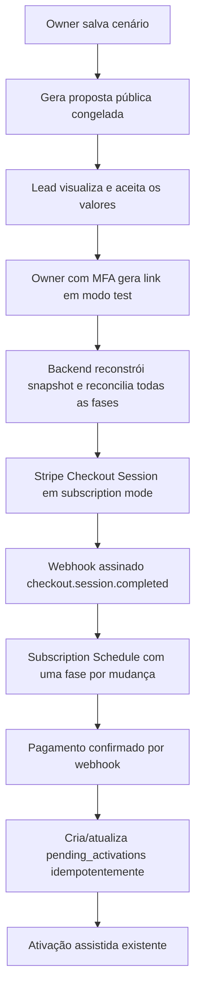

# Fórmulas, fases e fluxos

## Capacidade adicional

```text
demanda = max(pacientesAtuais, previsaoEm12Meses)

blocosMinimos =
  ceil(max(demanda - limiteBase, 0) / tamanhoDoBloco)

blocosSelecionados =
  max(blocosMinimos, overrideDoOwnerValido)

limiteTotalContratado =
  limiteBase + blocosSelecionados × tamanhoDoBloco

receitaMensalDosBlocos =
  blocosSelecionados × precoDoBloco

receitaMensalClinicalCore =
  precoBasePersonalizado + receitaMensalDosBlocos

armazenamentoIncluidoMb =
  limiteTotalContratado × includedStorageMbPerPatient
```

Política inicial da nova versão v3:

| Campo | Valor |
|---|---:|
| Bloco | 10 pacientes |
| Preço | R$ 79,90/mês |
| Armazenamento | 100 MB/paciente |
| Tolerância | 7 dias |
| Ajuste | próximo ciclo |
| Bloqueio clínico | nunca |

| Demanda | Blocos | Limite | Blocos/mês | Clinical Core/mês | Armazenamento |
|---:|---:|---:|---:|---:|---:|
| 150 | 0 | 150 | R$ 0,00 | R$ 1.599,00 | 15.000 MB |
| 151 | 1 | 160 | R$ 79,90 | R$ 1.678,90 | 16.000 MB |
| 160 | 1 | 160 | R$ 79,90 | R$ 1.678,90 | 16.000 MB |
| 161 | 2 | 170 | R$ 159,80 | R$ 1.758,80 | 17.000 MB |
| 200 | 5 | 200 | R$ 399,50 | R$ 1.998,50 | 20.000 MB |

### Versionamento seguro

```text
v1 arquivada: custom_capacity_policy = null
v2 ativa:     custom_capacity_policy = null

clone(v2 -> v3 draft):
  v3.custom_capacity_policy =
    coalesce(v2.custom_capacity_policy, POLITICA_PADRAO)

publish(v3):
  exige politica valida
  catalog_snapshot.customCapacityPolicy = v3.custom_capacity_policy
  arquiva v2 pelo fluxo normal
```

Catálogos históricos sem política continuam calculando o pacote
personalizado pelo limite e preço já congelados, sem inventar blocos. O motor
só calcula blocos quando a versão selecionada está `active` e contém política
versionada válida.

## Ordem de descontos

1. Congelar preço normal do item.
2. Aplicar o desconto temporário do item.
3. Aplicar desconto global proporcionalmente sobre o preço remanescente.
4. Alocar o resíduo de centavos no `clinical_core`.
5. Exigir justificativa quando desconto global e de item incidirem juntos.
6. Bloquear qualquer resultado negativo ou desconto acima do preço.
7. Após o término do item, restaurar o preço normal congelado sem remover o módulo.

## Matriz de descontos e fases

| Situação | Fase | Gestão Escolar | Demais módulos | Implantação |
|---|---|---:|---:|---:|
| Plural Multi | meses 1–6 | R$ 0,00 | preço contratado | somente primeira fatura |
| Plural Multi | mês 7 em diante | R$ 349,00 | preço contratado | não repete |
| Dois módulos com términos diferentes | uma fase por limite temporal | preço vigente no intervalo | preço vigente no intervalo | somente primeira fase |
| Item revogado | próxima fase | preço normal | sem alteração | não repete |

Em cada fase:

```text
receitaRecorrente = soma(linhasMensais)
custoRecorrente = soma(custosDiretos) + custosCompartilhadosAlocados
contribuicao = receitaRecorrente - custoDireto - transacao - impostos
EBITDA = contribuicao - custosCompartilhados
margemBps = round(EBITDA × 10.000 / receitaRecorrente)
faturaInicial = receitaRecorrente + implantacaoOneTime
faturasSeguintes = receitaRecorrente
```

A soma das linhas é validada em centavos contra cada fase e contra o consolidado.

## Fluxo Stripe assistido



Não existe chamada Stripe no cálculo da proposta.

## Estados do link

| Estado | Significado |
|---|---|
| `active` | criado e disponível |
| `sent` | enviado pelo owner |
| `opened` | redirecionamento público aberto |
| `payment_pending` | Checkout concluído, pagamento ainda pendente |
| `completed` | pagamento confirmado |
| `expired` | sessão ou link expirado logicamente |
| `failed` | assinatura existente com falha de cobrança |

## Eventos

Eventos reutilizados:

- `proposal_created`
- `proposal_sent`
- `checkout_created`
- `checkout_sent`
- `checkout_opened`
- `payment_pending`
- `payment_completed`
- `activation_sent`
- `activation_completed`
- `checkout_expired`

Quando o enum existente não possui um evento próprio para ciclo do Schedule ou desconto, usa-se `lead_updated` com `metadata.action`, preservando compatibilidade.

## Webhooks tratados

- `checkout.session.completed`
- `checkout.session.expired`
- `invoice.paid`
- `invoice.payment_succeeded` por compatibilidade existente
- `invoice.payment_failed`
- `customer.subscription.created`
- `customer.subscription.updated`
- `customer.subscription.deleted`
- `subscription_schedule.created`
- `subscription_schedule.updated`
- `subscription_schedule.completed`
- `subscription_schedule.canceled`

## Evolução clínica

- Modelo: conteúdo sanitizado, snapshot independente, referência e versão preservadas.
- Vínculo: no máximo cinco ativos por paciente/tenant, um principal, sem duplicidade ativa.
- Substituição: encerra o vínculo anterior, mantém histórico e congela versões autorizadas.
- Plano: `specialty` ou `interdisciplinary`; edição exige vínculo, participação e `write`.
- Concorrência: `expectedVersion` precisa coincidir com `edit_version`, senão HTTP 409.
- ABA: profissional, especialidade, sessão, organização e peso de agregação são congelados no registro.

Agregações:

| Métrica | Agregação |
|---|---|
| frequência, duração total, tentativas | soma |
| percentual de acertos, intervalos | média ponderada por tentativas |
| duração média, latência | média |
| domínio, manutenção, generalização, regressão/status | estado histórico mais recente |
